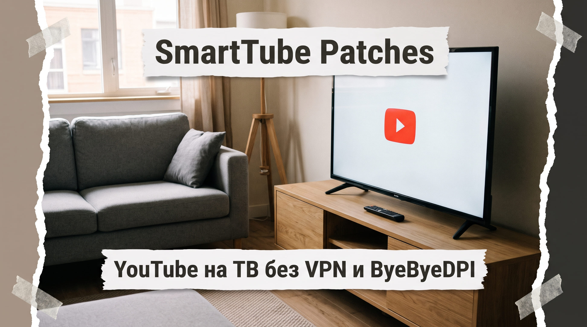

# SmartTube Patches (`doroved-patch`)

Набор патчей и автоматизированная сборка **SmartTube** с подменой TLS SNI на `www.google.com` для доменов YouTube, коротким таймаутом TLS для `*.googlevideo.com` и оптимизацией переключения клиентов/движка.

> Исходный проект: [yuliskov/SmartTube](https://github.com/yuliskov/SmartTube)

---

## Что делают патчи

1. **Кастомный TLS SNI (`www.google.com`)** для доменов YouTube (остальные домены не затрагиваются):
   - `youtu.be`, `youtube.com`, `*.youtube.com`
   - `*.googlevideo.com`
   - `*.ytimg.com`, `*.ggpht.com`, `yt3.googleusercontent.com`, `lh*.googleusercontent.com`
   - `youtubei.googleapis.com`
   - Проверка цепочки доверия сертификатов сохранена (`CustomSniHostnameVerifier` проверяет сертификат на совпадение с исходным хостом или `www.google.com`).
   - Покрыты все сетевые стеки приложения: **OkHttp** (API, Retrofit, ExoPlayer, Lounge), **HttpsURLConnection** (Glide для обложек/аватарок, `DefaultHttpDataSource`), корректно работает на Android 10+ (делегирование ALPN `getApplicationProtocol`).
2. **Таймаут 3 секунды для `*.googlevideo.com`:**
   - На TCP-подключение и TLS-хендшейк к `*.googlevideo.com` выставлен таймаут `3000 мс` (после успешного хендшейка исходный таймаут сокета восстанавливается). Заблокированные/зависшие узлы CDN быстро сбрасываются.
3. **Фиксация движка на `OkHttp`:**
   - Cronet отключён в пользу `OkHttp` (нативный BoringSSL в Cronet обходит Java `SSLSocketFactory`).
   - При ошибке `"Unable to connect to"` движок не уходит на `Default`, а сбрасывает кэш форматов, чтобы YouTube выдал другой поддомен `*.googlevideo.com`.
4. **Оптимизация списка клиентов воспроизведения:**
   - В `FormatInfoWrapper` оставлены клиенты `TV`, `TV_SAMSUNG`, `WEB` и `IOS` — быстрое переключение без лишнего перебора, при этом сохранена работа прямых эфиров (DASH/HLS).
5. **Версионирование патчей (`PATCH_VERSION`) и автообновление:**
   - Используется сквозная версия патча (`v1`, `v2`, ...), отображаемая в разделе **Настройки → О приложении** (`by doroved-patch v<N>`).
   - `versionCode` вычисляется по формуле `upstreamVersionCode * 1000 + patchVersion`, чтобы обновления патча корректно ставились поверх без конфликта с будущими релизами SmartTube.
   - Встроенная проверка обновлений (`update_urls.xml`) переведена на `stable.json` этого репозитория — новые версии патча и SmartTube приходят прямо на ТВ.
6. **Автоочистка кэша при обновлении:**
   - При смене `versionCode` приложение автоматически очищает свой `cacheDir` (старый кэш JS-плеера / `poToken`), не затрагивая аккаунт, подписки и настройки.

---

## Решение проблем

- **Некоторые видео периодически не запускаются в разное время суток:**
  из-за нестабильной работы или ограничений на серверах GGC (`*.googlevideo.com`) у отдельных провайдеров часть видео может временно не открываться. Обычно помогает повторный запуск видео позже или смена сети/DNS.
- **Ошибка `403` или `PoToken error` после обновления или восстановления бэкапа:**
  откройте настройки Android TV → **Приложения → SmartTube** → **Остановить (Принудительно остановить)** → **Очистить кэш**, затем запустите приложение снова.
- **Первый запуск видео после чистой установки или очистки кэша занимает ~20–30 секунд:**
  это нормально — SmartTube один раз скачивает JS-плеер YouTube и генерирует `PoToken`. Все последующие видео запускаются за 1–2 секунды.

---

## Установка APK на Android TV

1. Скачайте нужный APK из раздела **[Releases](../../releases)**:
   - `*_universal.apk` — подходит для любых устройств (ARMv7 + ARM64 + x86).
   - `*_armeabi-v7a.apk` — большинство Android TV и приставок (32-bit).
   - `*_arm64-v8a.apk` — 64-битные устройства (Nvidia Shield и др.).
2. Если ранее был установлен официальный SmartTube Stable (`org.smarttube.stable`), его нужно удалить один раз из-за разной подписи (при желании предварительно сделайте бэкап настроек в приложении).
3. Все последующие релизы из этого репозитория подписываются одним и тем же ключом и устанавливаются поверх без удаления настроек.

---

## Структура репозитория

- `01-sharedmodules-custom-sni.patch` — патч для подмодуля `SharedModules` (`CustomSni*`, `OkHttpCommons`, юнит-тесты `CustomSniTest`).
- `02-mediaservicecore-custom-sni.patch` — патч для подмодуля `MediaServiceCore` (`LoungeService`, `FormatInfoWrapper`).
- `03-smarttube-custom-sni.patch` — патч для основного репозитория `SmartTube` (`MainApplication`, `ExoMediaSourceFactory`, `Utils`, `ErrorFixerController`, `About*`, `build.gradle`).
- `PATCH_VERSION` — текущая сквозная версия патча (целое число `1..999`).
- `apply_custom_sni.sh` — скрипт применения всех 3 патчей.
- `build_release.sh` — локальный скрипт прогона тестов и сборки подписанных APK.
- `.github/workflows/build.yml` — GitHub Actions workflow для автоматической проверки новых тегов SmartTube, сборки релизов и обновления `stable.json`.

---

## Локальная сборка

Требования: **JDK 17** (Gradle 7.5 / R8 несовместимы с JDK 21+) и Android SDK.

```bash
# 1. Клонировать нужный тег SmartTube с подмодулями
VERSION=32.80
git clone --depth 1 --branch "$VERSION" --recurse-submodules --shallow-submodules \
  https://github.com/yuliskov/SmartTube.git ../SmartTube

# 2. Применить патчи
./apply_custom_sni.sh ../SmartTube

# 3. Подготовить keystore.properties (с вашим ключом подписи) и собрать APK
./build_release.sh ../SmartTube
```

---

## Настройка GitHub Actions

Для автоматической сборки релизов добавьте в **Settings → Secrets and variables → Actions** следующие секреты:
- `KEYSTORE_BASE64` — ваш `.keystore`, закодированный в base64 (`base64 -w 0 release.keystore` на Linux или `base64 -i release.keystore` на macOS)
- `KEYSTORE_PASSWORD` — пароль хранилища
- `KEY_ALIAS` — алиас ключа
- `KEY_PASSWORD` — пароль ключа
